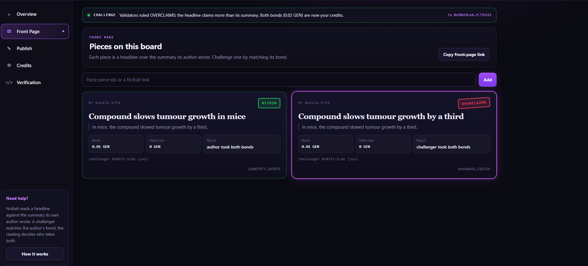

NoBait does not judge whether a story is true, and it does not grade clickbait on a scale. It asks whether a headline claims more than the summary beneath it supports — and anyone who doubts that can put down a bond equal to the author's to have it read.

<p align="center"></p>

# NoBait

A headline on a bond, read against its own summary by GenLayer validators. GenLayer StudioNet (chain 61999) · py-genlayer v0.2.

**The contract holds GEN.** It holds the bond of every open piece and every wallet's **credits** (bonds won, refunded
or retired, not yet withdrawn). Each wallet takes its credits out with `withdraw`. GEN moves between the two sides only
when a challenge is ruled.

| | |
|---|---|
| Contract source | `contracts/HeadlineBound.py` (SHA-256 in `SOURCE_SHA256.txt`) |
| Project deployment | [`0xAa76b8A17086938eF9474150f272bfEaC76d216F`](https://explorer-studio.genlayer.com/address/0xAa76b8A17086938eF9474150f272bfEaC76d216F) |
| Intelligent Contract | HeadlineBound — the same frozen source, deployed separately at [`0x34149cE0A6cCd7728E94A1898674e60475a716bc`](https://explorer-studio.genlayer.com/address/0x34149cE0A6cCd7728E94A1898674e60475a716bc) |
| Live app | https://no-bait.vercel.app |
| Evidence | `RUNTIME_EVIDENCE.md` (one tx hash per row) · `TESTING.md` |

## What it does

An author publishes a headline together with the summary it sits on, and locks a bond. Anyone else may challenge the
piece **once** by locking exactly the same bond. Validators read the pair once and decide one thing: does the headline
claim more than the summary supports?

| Ending | Who receives both bonds | Piece |
|---|---|---|
| `OVERCLAIMS` | the challenger | stamped `RULED_OVERCLAIMS` for good |
| `WITHIN` | the author | stamped `RULED_WITHIN`, cannot be challenged again |
| `VOID` (no usable reading) | each side gets its own bond back | closed |

On StudioNet, over the summary `In mice, the compound slowed tumour growth by a third.`, the headline
`Compound slows tumour growth by a third` was ruled **OVERCLAIMS** and `Compound slows tumour growth in mice` **WITHIN** —
same challenger, same bond, opposite payouts, both in the contract run and through this app. Under one headline, `Council closes the library on Sundays`, a council that
*discussed* closing it was OVERCLAIMS and a council that *voted* to close it was WITHIN.



While a piece is still open, its author can retire it and take the bond back. The author cannot challenge their own piece.

## What the app shows

- **Overview**: the three endings and the connected contract.
- **Front page**: each piece as a news block — headline, the summary beneath it, an outcome stamp (OVERCLAIMS, WITHIN,
  VOID, RETIRED or OPEN), the bond and how much is still held. *Challenge* shows the exact bond it will send and is
  disabled with the contract's own sentence when you are the author. The front-page link carries every piece on it.
- **Publish**: summary, headline and bond, with a live calldata byte meter; the piece id is shown before you sign.
- **Credits**: your credits held by the contract, and *Withdraw*.
- **Verification**: contract address, source SHA-256 and the rubric hash read from `get_limits`.

After every write the app waits for consensus to accept it, re-reads the contract, and only then reports what happened
— for a challenge, the ruling and where the bonds went.

## How to try it

You need **two wallets** on GenLayer StudioNet, each with a little GEN. Nothing depends on existing data.

1. **Wallet A** — *Publish*: summary `In mice, the compound slowed tumour growth by a third.`, headline
   `Compound slows tumour growth by a third`, bond `0.01`. Publish again with the same summary and the headline
   `Compound slows tumour growth in mice`. (Write your own pair if those already exist.) Copy the front-page link.
2. **Wallet B** — open the link and *Challenge* both pieces. The first is stamped OVERCLAIMS and both bonds become B's
   credits; the second is stamped WITHIN and both bonds go to A.
3. **Wallet A** — open the link: Challenge is disabled with "The author cannot challenge their own piece" on any open
   piece of yours. Open *Credits* and *Withdraw*; do the same with B.

## Methods

| Write | Who | Checks, in order |
|---|---|---|
| `publish(headline, summary)` (payable) | anyone | headline 1–90 → summary 1–240 → no reserved token → bond 0.001–1 GEN → not published before |
| `challenge(piece_id)` (payable) | anyone but the author | known id → OPEN → not the author → value equals the bond → **the only model call** |
| `retire(piece_id)` | the author | known id → OPEN → author |
| `withdraw()` | any wallet with credits | credits > 0 → zero, then send |

Views return JSON strings with amounts as decimal strings: `get_piece`, `get_credits`, `get_rubric`, `get_limits`.
The full specification is in `LOCKED_SPEC.md`.

## Run locally

```bash
npm ci
npm run dev            # http://localhost:5173 (the /genlayer-rpc proxy is in vite.config.ts)
npm run build && npm test
npm run verify:source
python3 -m pytest tests/contract -q -p no:cacheprovider   # needs genlayer-test 0.29.2
```

`VITE_CONTRACT_ADDRESS` overrides the deployment address. On Vercel, `vercel.json` declares the same proxy.

## Honest limitation

1. **The contract holds GEN**: the bonds of open pieces and the credits nobody has withdrawn yet.
2. **No fact-checking.** The summary may itself be wrong; NoBait only measures the headline against the summary its own
   author wrote.
3. **One reading, no appeal.** `RULED_*` is permanent; a model mistake cannot be corrected.
4. **Both wrong labels have a victim** — a wrong OVERCLAIMS costs the author, a wrong WITHIN costs the challenger. Nets:
   equal bonds on both sides, and the VOID path that refunds both when validators cannot give a usable answer.
5. **An author can challenge their own piece from a second wallet** to collect a WITHIN stamp; the contract does not
   prove that a wallet is a person.
6. **Calldata limits long pieces.** A headline and summary longer than about 224 characters together are not proven
   (the contract caps are 90 + 240); the publish form stops at 255 bytes.

License: MIT.
