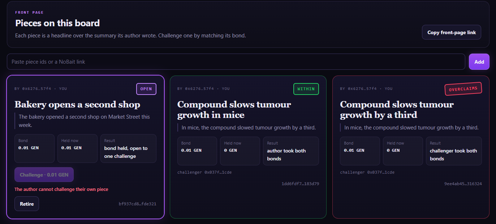
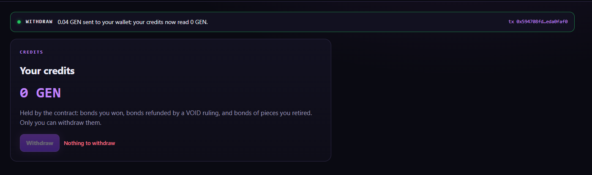

# RUNTIME_EVIDENCE

```
COMPILE PASS ≠ RUNTIME PASS
SUBMITTED ≠ ACCEPTED ≠ FINALIZED ≠ EXECUTION SUCCESS ≠ POSTCONDITION PASS
```

Both deployments run the same frozen source, SHA-256 `e21aa2fe1e5cf42f2e4c68ae904235578a5491781ce30389dbecb373077e21f9`.

## Project run (address `0xAa76b8A17086938eF9474150f272bfEaC76d216F`, through this app)

Run date 2026-10-06, app at https://no-bait.vercel.app, MetaMask on StudioNet. Deploy tx [`0xfb61824e…617b0958`](https://explorer-studio.genlayer.com/tx/0xfb61824ea8771039b020fda8b1e3171155e3d8cbe9ac84cbcc2287c0617b0958). **11 transactions**, all FINALIZED.

Wallets: **A** = author `0x6276095FAEA15108740445ff277fdA8c304657F4` · **B** = challenger `0x037f58E33c1Ec8fdA272361E0aAC1e31054a1CDE`. Every bond is 0.01 GEN, entered in the app.

| # | Wallet | Action in the app | Expected | Tx hash | Result (read back by the app from the accepted state) |
|---|---|---|---|---|---|
| P1 | A | Publish O1 and W1: summary `In mice, the compound slowed tumour growth by a third.` under `Compound slows tumour growth by a third` and under `Compound slows tumour growth in mice` | two OPEN pieces, ids shown before signing | [`0x3dfe8dfe…4ea1abd4`](https://explorer-studio.genlayer.com/tx/0x3dfe8dfe4e65f165f17f456edb8678b35e808ab01e34dd5dda6a6cb74ea1abd4) · [`0x3bbb16b9…c98a4851`](https://explorer-studio.genlayer.com/tx/0x3bbb16b9d2c60ab8f54f6f7d3a40bfb8cd1bdfe24be746803b69e5c2c98a4851) | SUCCESS; both OPEN, 0.01 GEN held each (`9ee4ab45…316324`, `1dd6fdf7…183d79`) |
| P2 | B | Challenge "…in mice" | WITHIN | [`0x8acfc08e…7efc01ff`](https://explorer-studio.genlayer.com/tx/0x8acfc08e653d152af810b547411a9321ea97ace13e2e2e4504520fbd7efc01ff) | **WITHIN** — "author took both bonds", held 0 |
| P3 | B | Challenge "…by a third" | OVERCLAIMS | [`0x50b19ce4…fc77e522`](https://explorer-studio.genlayer.com/tx/0x50b19ce48dd5c1ed46a61872bfb5ddaeebf661ceca82a98a999f8bdbfc77e522) | **OVERCLAIMS** — "Both bonds (0.02 GEN) are now your credits" |
| P4 | A | Publish `Bakery opens a second shop` over `The bakery opened a second shop on Market Street this week.` | OPEN | [`0xe7d50b39…4836f8fb`](https://explorer-studio.genlayer.com/tx/0xe7d50b39898e4d24e0e0b2a21566c40a0aacf56733390f621c453e904836f8fb) | SUCCESS; OPEN |
| P5 | A | Challenge button on that open piece | disabled with *The author cannot challenge their own piece* | — (not sent) | disabled with that sentence (screenshot 2) |
| P6 | B | Challenge the bakery piece (extra ruling) | — | [`0x3df95afd…6f24ad74`](https://explorer-studio.genlayer.com/tx/0x3df95afd61267212094571f1e42119f12859c33425353095fab63b846f24ad74) | **WITHIN** — author took both bonds |
| P7 | A | Withdraw | A credits 0.04 GEN → 0 | [`0x594708fd…eda0faf0`](https://explorer-studio.genlayer.com/tx/0x594708fdd3d3032a70134764b1b2e361aa158a3b74377f8c455bcea9eda0faf0) | SUCCESS; "0.04 GEN sent to your wallet; your credits now read 0 GEN". Native transfer [`0x8f8f7c04…ecaa82b1`](https://explorer-studio.genlayer.com/tx/0x8f8f7c0491475975551b72f997cfdc3470b0e4db93652d10470ab4c7ecaa82b1) |
| P8 | B | Withdraw | B credits 0.02 GEN → 0 | [`0x67815a7a…92f716ff`](https://explorer-studio.genlayer.com/tx/0x67815a7aeb5e7583422285acc441d32bb656477536e6df2194f15ee592f716ff) | SUCCESS; "0.02 GEN sent to your wallet; your credits now read 0 GEN". Native transfer [`0x942bc04d…e1778edd`](https://explorer-studio.genlayer.com/tx/0x942bc04d4de3083d29bddea2141c6df3eaebd633efbb595f7653b3b4e1778edd) |

Accounting: A bonded 0.03 GEN and took back 0.04 (two WITHIN rulings at 0.02 each); B bonded 0.03 GEN and took back 0.02 (one OVERCLAIMS). 0.06 in, 0.06 out.

Screenshots:






Also: `docs/evidence/2b-third-piece-within.png` (the bakery piece ruled WITHIN) and `docs/evidence/3b-challenger-withdrew.png`.

Predictable reverts (author challenge, second challenge) are **not sent** from the app: the disabled button with the
contract's sentence, or the closed stamp, is the evidence.

## Intelligent Contract run (address `0x34149cE0A6cCd7728E94A1898674e60475a716bc`, Studio)

Contract [`0x34149cE0A6cCd7728E94A1898674e60475a716bc`](https://explorer-studio.genlayer.com/address/0x34149cE0A6cCd7728E94A1898674e60475a716bc) · deploy tx [`0xc5d4eec3…bff61467`](https://explorer-studio.genlayer.com/tx/0xc5d4eec38f61740a70573fc82461ae1d9c54dcb34be8b8e2aec33d81bff61467) · source SHA-256 `e21aa2fe1e5cf42f2e4c68ae904235578a5491781ce30389dbecb373077e21f9`. Run date 2026-10-06, GenLayer Studio, Normal (Full Consensus). **18 transactions**, all FINALIZED, every one listed below.

Wallets: **A** = author `0x6276095FAEA15108740445ff277fdA8c304657F4` · **B** = challenger `0xAD05365aFe0C2450d4FFBcdbE555b6E5fB7Dfa35`.

Each case is a pair: a summary and the headline that sits on it (`publish(headline, summary)`). Row 2 publishes the W1 headline on the summary O1 and W1 share; row 10 publishes the W4 summary under the headline O4 and W4 share.

**Every bond is 1 GEN** (`1000000000000000000` wei, the contract's maximum): the Studio value field takes whole GEN only. The deliberately wrong bond in row 8 is therefore 0 instead of a short amount; it fails on the same check. Credits are read with `get_credits` (no transaction).

Pieces (all published by A; id = keccak of author, headline and summary):

| Piece | Headline / summary | Piece id |
|---|---|---|
| P1 | O1 | `9ee4ab459dcb19619fe077709ad03075b872c14f7bac7feb37a8b84f1f316324` |
| P2 | W1 | `1dd6fdf77274501af27a7c0cbdd0ed14326948856e1142db5eccc6665f183d79` |
| P3 | O4 | `344a01f82376e14ef409753b64330126826aab56c3bc3c8cd54bb2c5fb71df17` |
| P4 | W4 | `7b5ebc0f84251807991c021f50f9ea8e13d39d7349c40e51f57ea4146a0d1bab` |
| P5 | Bakery | `bf937cd8039f6002fdeebc301acee38dc8cf6154e64d2359e9bb759136fde321` |

| # | Wallet | Call | Expected | Tx hash | Result |
|---|---|---|---|---|---|
| 0 | A | deploy | — | [`0xc5d4eec3…bff61467`](https://explorer-studio.genlayer.com/tx/0xc5d4eec38f61740a70573fc82461ae1d9c54dcb34be8b8e2aec33d81bff61467) | SUCCESS |
| 1 | A | `publish(O1)` + 1 GEN | P1 OPEN | [`0x8df7fd26…21311e80`](https://explorer-studio.genlayer.com/tx/0x8df7fd26910cf0a2dccf3b11eee6f8dc65ca748506aeca68735ae35121311e80) | SUCCESS; `get_piece(P1)`: OPEN, bond_wei `1000000000000000000`, held_wei `1000000000000000000` |
| 2 | A | `publish(W1)` + 1 GEN | P2 OPEN (same summary as P1) | [`0xb61c13ab…748a303d`](https://explorer-studio.genlayer.com/tx/0xb61c13ab47d93644404dafde17f8583c34e6fa323f008b45c80c5652748a303d) | SUCCESS |
| 3 | B | `challenge(P1)` + 1 GEN | OVERCLAIMS — **Check 1a · Check 3** | [`0x8d96e134…186c30f9`](https://explorer-studio.genlayer.com/tx/0x8d96e134b84aa288a02b4d6b0322a37502ff333a24f1ce82b11a2fac186c30f9) | **OVERCLAIMS**; P1 RULED_OVERCLAIMS; B credits `2000000000000000000` |
| 4 | B | `challenge(P2)` + 1 GEN | WITHIN — **Check 1b · Check 3** | [`0x05c2a624…6390e284`](https://explorer-studio.genlayer.com/tx/0x05c2a624208802938bcdcd73beeab418b9afd6e08589a89b10e7c9446390e284) | **WITHIN**; A credits `2000000000000000000`, B stays `2000000000000000000` |
| 5 | B | `challenge(P1)` | revert *This piece is no longer open to challenge* | [`0xa49dbd94…debbde8e`](https://explorer-studio.genlayer.com/tx/0xa49dbd9445bc87530671ddc378d09ed48619928feee69d4eb57b5d62debbde8e) | reverted, *This piece is no longer open to challenge* |
| 6 | A | `publish(O4)` + 1 GEN | P3 OPEN | [`0xf94b2b1d…faa6e8c9`](https://explorer-studio.genlayer.com/tx/0xf94b2b1d775fe9867bce92bf8eacb804c777a187bd3b9ef52ab5129cfaa6e8c9) | SUCCESS |
| 7 | A | `challenge(P3)` | revert *The author cannot challenge their own piece* | [`0x1df28e47…d326e924`](https://explorer-studio.genlayer.com/tx/0x1df28e478726b8c1b9d682fd8d6c939906a966d7b947d06d365f7d58d326e924) | reverted, *The author cannot challenge their own piece* |
| 8 | B | `challenge(P3)` + 0 | revert *The challenge bond must equal the author's bond* | [`0x624d6f5c…23d1d3f3`](https://explorer-studio.genlayer.com/tx/0x624d6f5ca4431f9bfff315390d2b7b5143251c5fccbf5ec10893769923d1d3f3) | reverted, *The challenge bond must equal the author's bond* |
| 9 | B | `challenge(P3)` + 1 GEN | OVERCLAIMS — **Check 2a** | [`0xf50125f3…8fe722fa`](https://explorer-studio.genlayer.com/tx/0xf50125f3d851f3cc798be73a3cab4bf204bfe0e6a6855ac31e0f77a08fe722fa) | **OVERCLAIMS**; B credits `4000000000000000000` |
| 10a | A | `publish(W4)` + 1 GEN | P4 OPEN (same headline as P3) | [`0x7965d207…f233fb8e`](https://explorer-studio.genlayer.com/tx/0x7965d2076a666c6595487892794dcfbac9c00714d555fb3ec643bfdcf233fb8e) | SUCCESS |
| 10b | B | `challenge(P4)` + 1 GEN | WITHIN — **Check 2b** | [`0x1249f29c…7c01df89`](https://explorer-studio.genlayer.com/tx/0x1249f29c6ed3c61b227a2a8b81f8b9c9fa37ceecfd40baf6869bc7ae7c01df89) | **WITHIN** after one leader rotation (see below); A credits `4000000000000000000` |
| 11a | A | `publish("Bakery opens a second shop", "The bakery opened a second shop on Market Street this week.")` + 1 GEN | P5 OPEN | [`0x2f92ef93…89fc8be1`](https://explorer-studio.genlayer.com/tx/0x2f92ef93ff85df84819e0e717d8f01b5eb5922679c474c7cab59c86889fc8be1) | SUCCESS |
| 11b | A | `retire(P5)` | bond back in credits | [`0x0bbdaab3…dcc15271`](https://explorer-studio.genlayer.com/tx/0x0bbdaab34bec449bc3f6b422694078d9864d4108c4835718094f9e52dcc15271) | SUCCESS; A credits `5000000000000000000` |
| 12a | A | `withdraw()` | 5 GEN reaches A — **Payout check** | [`0xfc8b4339…bd6d216a`](https://explorer-studio.genlayer.com/tx/0xfc8b4339bd32fe5728d880727a90153ef1fd8542fa751d5c3cd66066bd6d216a) | SUCCESS; A credits `0`; native transfer from the contract [`0xe9dcd677…7cbb0618`](https://explorer-studio.genlayer.com/tx/0xe9dcd6774764a2dac56bc545d83011f9cf7b0cbc31b1ef3ebb4e7da07cbb0618); wallet A ends at 1,010.274 GEN, its balance before the run |
| 12b | B | `withdraw()` | 4 GEN reaches B — **Payout check** | [`0x783e005f…9dc9c84f`](https://explorer-studio.genlayer.com/tx/0x783e005fe4b040f8e901e7bf18f4026e2f7015b0558c6aca1d3f72eb9dc9c84f) | SUCCESS; wallet B **6.008 → 10.008 GEN**; B credits `0`; native transfer from the contract [`0xebc1f71d…48830661`](https://explorer-studio.genlayer.com/tx/0xebc1f71d22d8cca093127d7558c25b03903e61b38b54b06d80ad835748830661) |
| 13 | — | `get_piece(P1)` | read | — (read) | RULED_OVERCLAIMS, challenger `0xad05…fa35`, outcome OVERCLAIMS, open_to_challenge false, held_wei `0` |

Must-verify rows:

- **Check 1** — O1 → OVERCLAIMS and W1 → WITHIN on the same summary (rows 3, 4): **PASS**
- **Check 2** — O4 → OVERCLAIMS and W4 → WITHIN under the same headline (rows 9, 10b): **PASS**
- **Check 3** — credits follow the outcome table after every ruling: **PASS** (B 2 → 2 → 4 GEN; A 2 → 4 → 5 GEN after the retire)
- **Payout check** — withdraw sends real GEN to both wallets: **PASS** (B +4 GEN; A's 5 GEN of bonds came back, so the wallet ends where it began)

Notes from the run:

- **Row 10b went through a leader rotation.** In the first round three validators disagreed with the leader, so consensus rotated the leader and ran the judgement again; the second round was accepted as WITHIN. This is the fail-closed path working: no money moved until validators agreed.
- Overall, A put 5 GEN into bonds and took 5 GEN back (two WITHIN rulings at 2 GEN each, one retire at 1 GEN); B put in 4 GEN and took 4 GEN back (two OVERCLAIMS rulings). Each ruling moved both bonds to one side, exactly as the table says.

